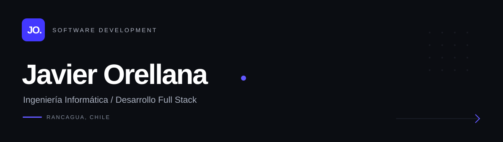

 

Me interesa entender cómo se construye el software, desde la lógica que lo hace funcionar hasta los detalles que definen cómo se utiliza.

Actualmente enfocado en el desarrollo web y en seguir fortaleciendo mis conocimientos técnicos.

 

---

### 01 / Tecnologías

**Frontend**

  

**Backend & Data**

  

**Tools**

  

 

---

### 02 / Más allá del código

Me interesa comprender cómo funcionan los sistemas y tomar decisiones técnicas que permitan construir software claro, útil y fácil de mantener.

Desarrollo web · Ingeniería de software · Experiencia de usuario

 

---

Javier Orellana · Rancagua, Chile

